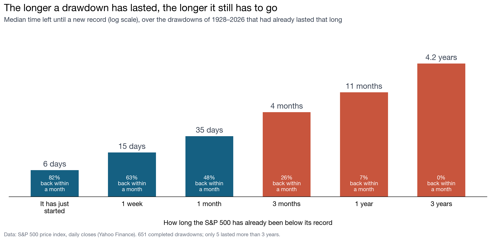

# The inspection paradox

**Why does the bus always seem late, why do your friends have more friends than you do, and
why does a stock market drawdown feel endless?**

An average depends on what you count. Count the items (gaps, people, drawdowns) and you get
one number. Count the ways of arriving at them (minutes, friendships, days) and big items show
up more often, so you get a larger number. Both are correct; they answer different questions.

| | Counting the items | Counting the ways of arriving |
|---|---|---|
| Bus gaps | 10 minutes | **12.5 minutes** |
| Facebook friends | 44 friends | **107 friends** |
| S&P 500 drawdowns | 54 days | **8.5 years** |

**Contents:** [Buses](#the-bus-stop) · [Friends](#your-friends) · [The formula](#the-formula) ·
[Drawdowns](#the-same-effect-in-the-stock-market) · [Code](#how-the-code-works) ·
[Run it](#run-it) · [Limitations](#limitations) · [Data](#data)

## The bus stop

Buses come in gaps that alternate between 5 and 15 minutes, so the average gap is 10 minutes.
But a passenger arrives at a random *minute*, not at a random gap, and 15 of every 20 minutes
are inside a long gap. Half of the gaps are long, yet three quarters of the time is.


The gap a passenger lands in lasts 12.5 minutes on average, and the wait for the next bus is
6.25 minutes, not the 5 that the timetable suggests. This is the **inspection paradox**: when
you sample a moment in time, long intervals are over-represented in proportion to their length.

## Your friends

Replace the gaps with people and the minutes with friendships. A person with 500 friends
appears in 500 lists of friends, so you are far more likely to know them than somebody with 5.

In a public network of 4,039 Facebook users and 88,234 friendships, the average person has
**44 friends** (median 25), but the person at the end of a random friendship has **107**
(median 83). One person in eight has 100 friends or more, and they fill 43% of all the places
in people's lists of friends.


The same holds person by person: for **87%** of the users, their friends have more friends
than they do on average.


It is not a quirk of one network. Three other public networks give the same direction:

| Network | People | Average person | Average friend | Fewer than their friends |
|---|---|---|---|---|
| Facebook (friends) | 4,039 | 43.7 | 106.6 | 87% |
| Deezer (mutual followers) | 28,281 | 6.6 | 16.2 | 86% |
| Last.fm (mutual followers) | 7,624 | 7.3 | 25.4 | 90% |
| GitHub (mutual followers) | 37,700 | 15.3 | 441.0 | 99% |

The more unequal the network, the larger the gap: on GitHub a few developers have thousands of
mutual followers ([figure](figures/four_networks.png)).

## The formula

If the sizes have mean E[X] and variance Var(X), the mean size of an item reached in
proportion to its size is

```
E[X*] = E[X] + Var(X) / E[X]
```

The second term is never negative, and it is zero only when every item has the same size. For
the buses, 10 + 25/10 = 12.5 minutes. For Facebook, 43.7 + 62.9 = 106.6 friends. The code
computes E[X*] both directly and from the formula, and the two agree.

<details>
<summary><b>Where it comes from</b></summary>

An item of size x is reached with probability x / Σx, so the mean size of what you reach is

```
E[X*] = Σ x · x / Σx = E[X²] / E[X] = (Var(X) + E[X]²) / E[X] = E[X] + Var(X) / E[X]
```

If you arrive at a uniformly random point inside the item, the mean time left is half of that,
E[X*] / 2: the 6.25 minutes of the bus stop.
</details>

## The same effect in the stock market

A **drawdown** is the time an index spends below its previous record: it runs from a record
close to the first close that is at least as high. Drawdowns are the gaps between buses, and
days are the minutes. Between 1928 and 2026 the S&P 500 completed **651** drawdowns and closed
below its record on 94% of trading days.

### Counted by drawdown and counted by day


| Length of a drawdown | Counting drawdowns | Counting days |
|---|---|---|
| Median | 6 days | **3.3 years** |
| Mean | 54 days | **8.5 years** |

82% of the drawdowns were over within a month, but they hold only 11% of the days. Four lasted
more than five years, and they hold 47%.


### How long until the next record?

This is the question an investor actually asks, and it is the bus passenger's wait. Pick a
random day on which the index is below its record and count the days left until a new one:

| Days left until a new record | Value |
|---|---|
| Mean | **4.2 years** |
| Median | **13 months** |
| Share of days with more than a year left | **52%** |

The typical drawdown is over in 6 days, yet on a typical drawdown day the record is more than
a year away.

### The longer it has lasted, the longer it still has to go

Waiting does not bring the end closer. Among the drawdowns that have already lasted a given
time, the median time left *grows* with the time already spent below the record:



| Already below the record for | Drawdowns still open | Back within a month | Median time left |
|---|---|---|---|
| Just started | 651 | 82% | 6 days |
| 1 month | 115 | 48% | 35 days |
| 1 year | 15 | 7% | 11 months |
| 3 years | 5 | 0% | 4.2 years |

This is the same inspection effect seen from inside: a drawdown that has survived a year is
much more likely to be one of the rare long ones. The last rows rest on very few drawdowns.

### Most of a long drawdown is the climb back

In the twelve falls of more than 20%, **75%** of the time was spent after the trough, climbing
back to the old record. The 1929 crash hit bottom in under three years and took 22 more to
recover. Depth and length go together: the deep drawdowns are the long ones.

### Does it survive other choices?

The size of the effect depends on the sample, and its direction does not:

| Sample | Drawdowns | Mean, counting drawdowns | Mean, counting days | Ratio |
|---|---|---|---|---|
| All, 1928–2026 | 651 | 54 days | 3,092 days | 58 |
| From the 1954 recovery onwards | 614 | 41 days | 962 days | 23 |
| Deeper than 20% | 12 | 1,824 days | 4,847 days | 2.7 |
| Price index, 1988–2026 | 418 | 32 days | 912 days | 28 |
| **With dividends reinvested**, 1988–2026 | 508 | 26 days | 666 days | 25 |

Reinvesting dividends makes the long drawdowns shorter (the dot-com one goes from 7.2 to 6.1
years), but the ratio barely moves.

### Why this matters in quantitative research

The "average drawdown length" in a backtest report counts drawdowns; what an investor lives
through counts days. Sampling through time favours what lasts long, and sampling through
connections favours what is well connected. Before trusting an average, ask what was counted:
the items, or the ways of arriving at them.

## How the code works

| File | What it does |
|---|---|
| `src/paradox.py` | The two averages, and friends of friends |
| `src/drawdowns.py` | Finds the drawdowns of a price series and the days left in them |
| `src/data.py` | Downloads and loads the networks and the S&P 500 |
| `src/run_analysis.py` | Computes every number in this README and writes it to `results/` |
| `src/plot_*.py` | One figure each, saved to `figures/` |
| `tests/` | Checks every function on small examples solved by hand |

The core is one line. The size-weighted average counts every item once per unit of its size:

```python
def weighted_mean(sizes) -> float:
    """Mean size when every item is counted in proportion to its size."""
    sizes = np.asarray(sizes, dtype=float)
    return float((sizes ** 2).sum() / sizes.sum())
```

`weighted_mean([5, 15])` returns 12.5, the bus example. A network is an array with one row per
friendship; `np.bincount` gives each person's number of friends. A drawdown is an unbroken run
of closes below the running maximum (`np.maximum.accumulate`).

## Run it

```bash
git clone https://github.com/renatacavilli/inspection-paradox.git
cd inspection-paradox
python -m venv .venv && source .venv/bin/activate
pip install -r requirements.txt
python src/run_analysis.py                     # rebuilds results/ and data/processed/
for f in src/plot_*.py; do python "$f"; done    # rebuilds figures/
pytest
```

The data are included, so nothing is downloaded and the results are identical on every run.
Tested with Python 3.14.

## Limitations

- **The Facebook network is not a random sample.** It joins the friend lists of ten survey
  participants (2012), so real numbers of friends are higher. On Deezer, Last.fm and GitHub a
  link means "follow each other", not friendship.
- **107 and 87% are two different comparisons** of the same effect: an average over all
  friendships, and each person against their own friends.
- **The long series is a price index.** Dividends are only available from 1988 (see the table
  above). Before March 1957 the series is the 90-stock composite that preceded the S&P 500.
- **One drawdown dominates.** 1929–1954 alone holds 26% of the days; the table above shows the
  results without it. Lengths are in calendar days; the 94% is a share of trading days.
- **Few long drawdowns.** Only 15 lasted more than a year, so the waiting table is a
  description of the past, not a forecast.
- **The bus timetable is an illustration**, not data.

## Data

| Series | Source |
|---|---|
| Facebook, Deezer, Last.fm and GitHub networks | [Stanford Network Analysis Project](https://snap.stanford.edu/data/) |
| S&P 500 price index, daily, 1927–2026 | [Yahoo Finance](https://finance.yahoo.com/quote/%5EGSPC/history/), `^GSPC` |
| S&P 500 total return index, daily, 1988–2026 | [Yahoo Finance](https://finance.yahoo.com/quote/%5ESP500TR/history/), `^SP500TR` |

Details of every file are in [`data/README.md`](data/README.md).

## References

- Feld, S. L. (1991). Why your friends have more friends than you do. *American Journal of Sociology*, 96(6), 1464–1477.
- Feller, W. (1971). *An Introduction to Probability Theory and Its Applications*, vol. 2, 2nd ed. Wiley. Section I.4, the waiting time paradox.
- Ugander, J., Karrer, B., Backstrom, L. and Marlow, C. (2011). The anatomy of the Facebook social graph. arXiv:1111.4503.
- McAuley, J. and Leskovec, J. (2012). Learning to discover social circles in ego networks. *NeurIPS*, 25.
- Rozemberczki, B. and Sarkar, R. (2020). Characteristic functions on graphs. *CIKM 2020*.
- Rozemberczki, B., Allen, C. and Sarkar, R. (2021). Multi-scale attributed node embedding. *Journal of Complex Networks*, 9(2).

## Licence

Code under the [MIT licence](LICENSE). The data keep the terms of their sources.
