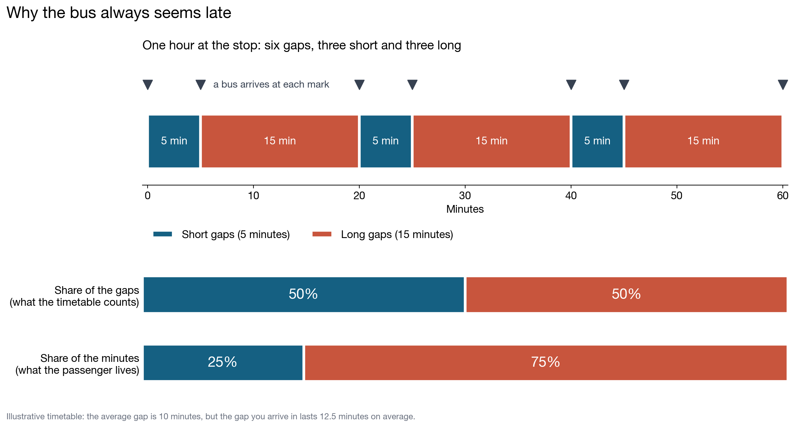
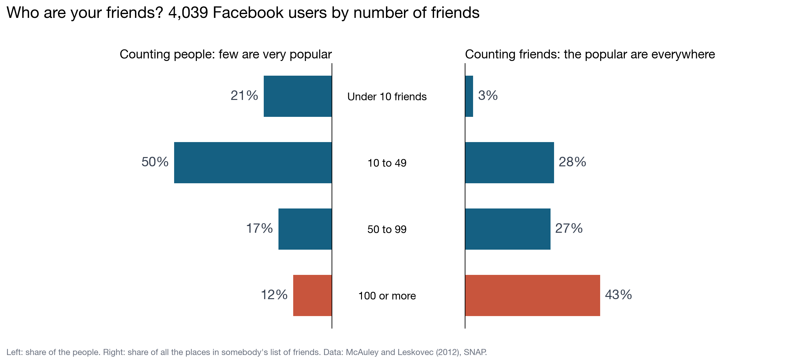
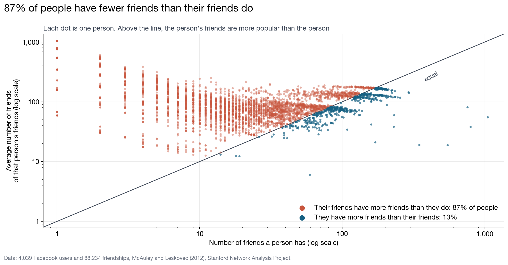
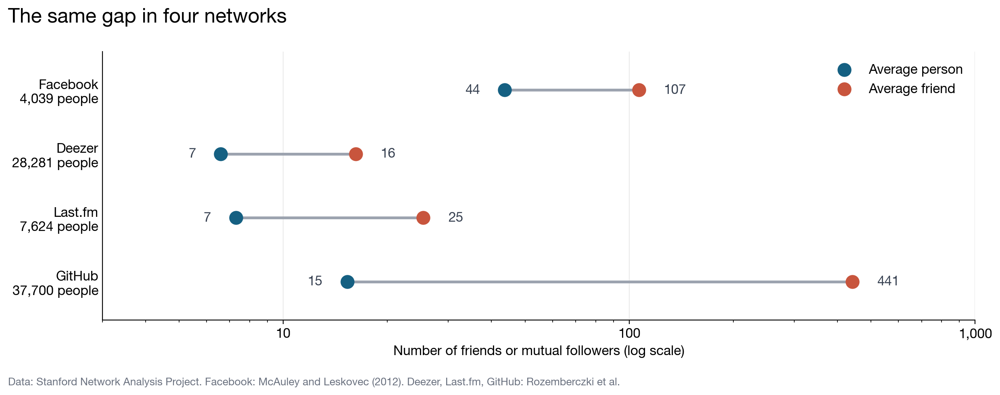
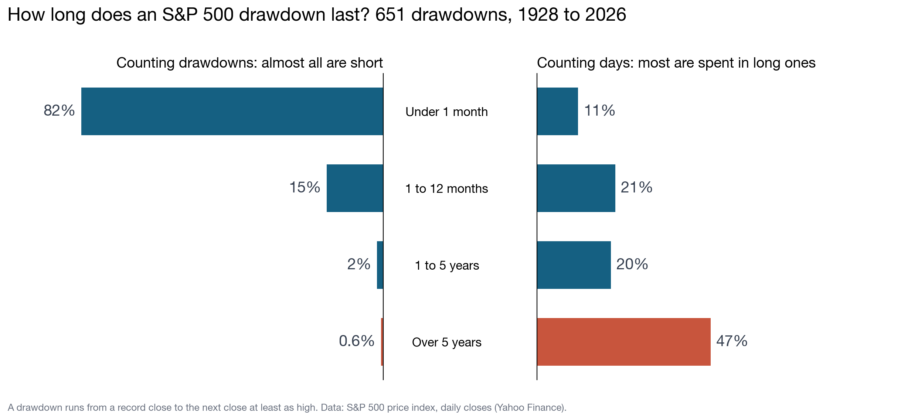
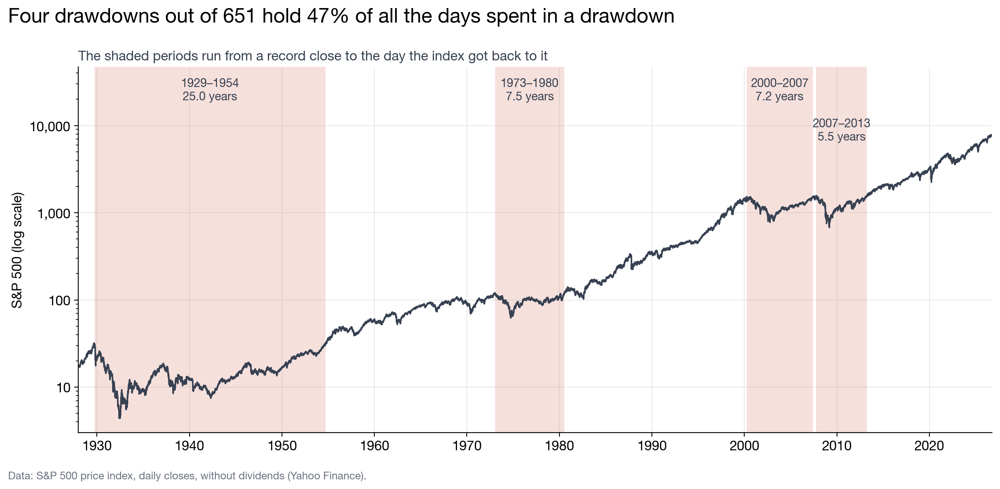

# The inspection paradox

**Why does the bus always seem late, and why do your friends have more friends than you do?**

In a network of 4,039 Facebook users the average person has **44 friends**, and the average
friend has **107**. Both figures are correct, and **87%** of the people have fewer friends
than their own friends do on average. This repository uses real public data to show why, and
it starts at a bus stop. It ends in the stock market, where the same effect decides how long
an [S&P 500 drawdown](#the-same-effect-in-the-stock-market) lasts.

**The idea in one line:** an average depends on what you count. Count the items (gaps, people,
drawdowns) and you get one number. Count the ways of arriving at them (minutes, friendships,
days) and big items show up more often, so you get a larger number.

| | Counting the items | Counting the ways of arriving |
|---|---|---|
| Bus gaps | 10 minutes | **12.5 minutes** |
| Facebook friends | 44 friends | **107 friends** |
| S&P 500 drawdowns | 54 days | **8.5 years** |

**Contents:** [The bus stop](#the-bus-stop) ·
[Your friends](#your-friends) ·
[The formula](#the-formula) ·
[Other networks](#is-it-only-this-network) ·
[The stock market](#the-same-effect-in-the-stock-market) ·
[Why it matters](#why-this-matters-in-quantitative-research) ·
[How the code works](#how-the-code-works) ·
[Run it](#run-it) ·
[Limitations](#limitations) ·
[Data](#data)



## The bus stop

Suppose buses come in gaps that alternate between 5 and 15 minutes. The average gap is 10
minutes. But a passenger does not arrive at a random gap, a passenger arrives at a random
minute, and 15 of every 20 minutes are inside a long gap.

| | Short gaps | Long gaps |
|---|---|---|
| Share of the gaps | 50% | 50% |
| Share of the minutes | 25% | **75%** |

The gap a passenger lands in lasts 12.5 minutes on average, not 10. This is the **inspection
paradox**: when you sample a moment in time, long intervals are over-represented in proportion
to their length.

## Your friends

Replace the gaps with people and the minutes with friendships. A person with 500 friends
appears in 500 lists of friends, so you are far more likely to know that person than somebody
with 5. Picking "a friend" is not the same as picking "a person".



| Number of friends | Counting people | Counting friends |
|---|---|---|
| Mean | 44 | **107** |
| Median | 25 | **83** |

"Counting friends" answers this question: pick a friendship at random and look at the person
at one end of it, how many friends does that person have?

One person in eight has 100 friends or more, and together they fill 43% of all the places in
people's lists of friends. The 21% of people with fewer than 10 friends fill 3%.

The figures above compare two averages over the whole network. The same thing shows up
person by person: for each user, compare their number of friends with the average number of
friends of their own friends.



For 87% of the people, their friends are more popular than they are.

## The formula

If the sizes of the items have mean E[X] and variance Var(X), the mean size of an item reached
in proportion to its size is

```
E[X*] = E[X] + Var(X) / E[X]
```

The second term is never negative, so what you land on is at least as large as the average,
and the two are equal only when every item has the same size. The more unequal the sizes, the
larger the difference.

| | E[X] | Var(X) / E[X] | E[X*] |
|---|---|---|---|
| Buses | 10 min | 2.5 min | 12.5 min |
| Facebook friends | 43.7 | 62.9 | 106.6 |

`src/run_analysis.py` computes E[X*] directly and from the formula, and the two agree.

<details>
<summary><b>Where the formula comes from</b> (three lines)</summary>

If an item of size x is reached with probability proportional to x, the probability of
reaching it is x / Σx. The mean size of what you reach is therefore

```
E[X*] = Σ x · (x / Σx) = Σx² / Σx = E[X²] / E[X]
```

and since E[X²] = Var(X) + E[X]²,

```
E[X*] = (Var(X) + E[X]²) / E[X] = E[X] + Var(X) / E[X]
```

For the buses: the gaps are 5 and 15, so E[X] = 10 and Var(X) = 25, which gives 10 + 2.5 = 12.5.
</details>

## Is it only this network?

The same calculation on three other public networks, of a different size and kind:



| Network | People | Average person | Average friend | Fewer than their friends |
|---|---|---|---|---|
| Facebook (friends) | 4,039 | 43.7 | 106.6 | 87% |
| Deezer (mutual followers) | 28,281 | 6.6 | 16.2 | 86% |
| Last.fm (mutual followers) | 7,624 | 7.3 | 25.4 | 90% |
| GitHub (mutual followers) | 37,700 | 15.3 | 441.0 | 99% |

The direction is the same everywhere. The size depends on how unequal the network is: on
GitHub a few developers have thousands of mutual followers, and the average friend has 29
times as many as the average person.

The exact figures are in [`results/`](results).

## The same effect in the stock market

A drawdown is the time an index spends below its previous record: it runs from a record close
to the first close that is at least as high. Drawdowns are the gaps between buses, and days
are the minutes.

Between 30 December 1927 and 7 October 2026 the S&P 500 completed **651** drawdowns, and it
closed below its record on 94% of trading days.



| Length of a drawdown | Counting drawdowns | Counting days |
|---|---|---|
| Median | 6 days | **1,193 days** (3.3 years) |
| Mean | 54 days | **3,092 days** (8.5 years) |

"Counting days" answers this question: pick at random a day spent in a drawdown, how long is
the drawdown it belongs to? Half of the drawdowns were over within 6 days, yet half of the
days belong to a drawdown that lasted more than 3 years. The formula gives the same answer:
54 + 3,038 = 3,092 days.

Of the 651 drawdowns, 536 were over within a month, and together they hold 11% of the days.
Four lasted more than five years, and they hold 47%.



The size of the effect depends on the sample, and its direction does not:

| Sample | Drawdowns | Mean, counting drawdowns | Mean, counting days | Ratio |
|---|---|---|---|---|
| All | 651 | 54 days | 3,092 days | 58 |
| From the 1954 recovery onwards | 614 | 41 days | 962 days | 23 |
| Deeper than 5% | 73 | 393 days | 3,752 days | 9.6 |
| Deeper than 10% | 26 | 962 days | 4,283 days | 4.5 |
| Deeper than 20% | 12 | 1,824 days | 4,847 days | 2.7 |

Leaving out the 25-year drawdown that began in 1929 cuts the ratio by more than half. Keeping
only the deep drawdowns removes the hundreds of tiny ones, so the lengths are less unequal and
the ratio falls, but even among falls of more than 20% the drawdown you land in is almost
three times as long as the average one.

## Why this matters in quantitative research

The way you reach your data decides what an average means. Sampling through time favours what
lasts long, and sampling through connections favours what is well connected. The "average
drawdown length" in a backtest report counts drawdowns, and what an investor lives through
counts days. Before trusting an average, it is worth asking what was counted: the items, or
the ways of arriving at them.

## How the code works

The whole analysis rests on three small ideas, each a few lines in `src/`.

**1. Two averages of the same sizes** (`src/paradox.py`). The plain average counts every item
once. The size-weighted average counts every item once per unit of its size, which is
Σx² / Σx:

```python
def weighted_mean(sizes) -> float:
    """Mean size when every item is counted in proportion to its size."""
    sizes = np.asarray(sizes, dtype=float)
    return float((sizes ** 2).sum() / sizes.sum())
```

`weighted_mean([5, 15])` returns 12.5, the bus example.

**2. Friends of friends** (`src/paradox.py`). A network is stored as an array with one row per
friendship, `[person_a, person_b]`. The number of friends of each person is how many times
their id appears in that array (`np.bincount`). To get the average number of friends of each
person's friends, every friendship adds the friend count of one end to the total of the other
end, and the total is divided by the person's own number of friends.

**3. Drawdowns** (`src/drawdowns.py`). A close is "below the record" when it is lower than the
highest close so far (`np.maximum.accumulate`). A drawdown is each unbroken run of such days,
from the last record before it to the first close that is at least as high again. Its length is
the number of calendar days between those two dates.

`src/run_analysis.py` loads the data, applies these functions and writes every number of this
README to `results/`. The `plot_*.py` scripts read the same data and draw one figure each.
The tests in `tests/` check each function on small examples whose answer is known by hand,
such as the bus gaps, a star network (one person linked to four others, who have one friend
each) or a triangle where everyone has the same number of friends.

## Repository layout

```
├── data/
│   ├── raw/                  the four lists of links and the daily S&P 500
│   ├── processed/            one row per S&P 500 drawdown
│   └── README.md             sources and descriptions
├── src/
│   ├── data.py               downloads and loads the data
│   ├── paradox.py            plain and size-weighted averages; friends of friends
│   ├── drawdowns.py          finds the drawdowns of a price series
│   ├── run_analysis.py       every number in this README
│   ├── plot_buses.py         figure 1
│   ├── plot_shares.py        figure 2
│   ├── plot_friends.py       figure 3
│   ├── plot_networks.py      figure 4
│   ├── plot_drawdown_shares.py   figure 5
│   ├── plot_drawdown_history.py  figure 6
│   └── style.py              shared colours and plot settings
├── tests/                    checks of the calculations on hand-made examples
├── figures/                  the six figures above
└── results/                  every number in this README, in five tables
```

## Run it

```bash
git clone https://github.com/renatacavilli/inspection-paradox.git
cd inspection-paradox
python -m venv .venv && source .venv/bin/activate
pip install -r requirements.txt
python src/run_analysis.py       # rebuilds results/ and data/processed/
python src/plot_buses.py
python src/plot_shares.py
python src/plot_friends.py
python src/plot_networks.py      # needs results/networks.csv
python src/plot_drawdown_shares.py
python src/plot_drawdown_history.py
pytest
```

Nothing is random, so the results are identical on every run. Tested with Python 3.14.

## Limitations

- **The Facebook network is not a random sample.** It joins the friend lists of ten survey
  participants, and it only contains friendships between people inside those lists. Real
  numbers of friends are higher.
- **Old data.** The Facebook data were published in 2012.
- **Different kinds of link.** On Deezer, Last.fm and GitHub a link is a pair of users who
  follow each other, which is not the same as a friendship.
- **Two different comparisons.** 107 is an average over all friendships. The 87% compares each
  person with the average of their own friends. They measure the same effect in two ways and
  need not agree in general.
- **The S&P 500 series is a price index, without dividends.** With dividends reinvested the
  index recovers sooner, so the long drawdowns are shorter than shown here. Before March 1957
  the series is the 90-stock composite that preceded the S&P 500.
- **One drawdown dominates.** The 1929 to 1954 drawdown alone holds 26% of the days. The table
  above shows the results without it.
- **Mixed units.** Drawdown lengths are in calendar days. The 94% figure is a share of trading
  days.
- **The bus timetable is an illustration.** It is arithmetic, not data.

## Data

| Series | Source |
|---|---|
| Facebook, Deezer, Last.fm and GitHub networks | [Stanford Network Analysis Project](https://snap.stanford.edu/data/) |
| S&P 500 price index, daily closes, 1927–2026 | [Yahoo Finance](https://finance.yahoo.com/quote/%5EGSPC/history/), ticker `^GSPC` |

See [`data/README.md`](data/README.md) for the source of each file.

## References

- Feld, S. L. (1991). Why your friends have more friends than you do. *American Journal of Sociology*, 96(6), 1464–1477.
- Feller, W. (1971). *An Introduction to Probability Theory and Its Applications*, volume 2, second edition. Wiley. Section I.4, the waiting time paradox.
- Stein, W. E. and Dattero, R. (1985). Sampling bias and the inspection paradox. *Mathematics Magazine*, 58(2), 96–99.
- Ugander, J., Karrer, B., Backstrom, L. and Marlow, C. (2011). The anatomy of the Facebook social graph. arXiv:1111.4503. The same effect measured on the whole of Facebook.
- McAuley, J. and Leskovec, J. (2012). Learning to discover social circles in ego networks. *Advances in Neural Information Processing Systems*, 25.
- Rozemberczki, B. and Sarkar, R. (2020). Characteristic functions on graphs: birds of a feather, from statistical descriptors to parametric models. *CIKM 2020*.
- Rozemberczki, B., Allen, C. and Sarkar, R. (2021). Multi-scale attributed node embedding. *Journal of Complex Networks*, 9(2).

## Licence

Code under the [MIT licence](LICENSE). The data keep the terms of their sources.
